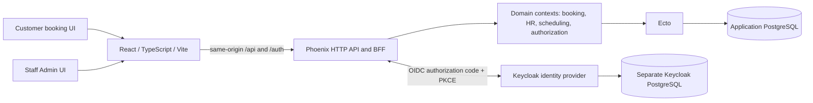

# Magnum

**A multi-tenant detailing operations platform — built with Elixir, Phoenix, React, and PostgreSQL.**

Magnum is an actively developed full-stack application for customer booking, multi-shop operations, employee management, and appointment staffing. The project explores how to build reliable workflows for service businesses where **scheduling conflicts, tenant boundaries, employee access, and historical records** matter as much as the user interface.

> **Status: active development / portfolio project.** Customer booking, authenticated administration, employee HR workflows, appointment calendars, and crew management are implemented. Some management features currently exist only as protected backend APIs. Self-service SaaS onboarding, white-label customer sites, subscriptions, and production deployment are **not** implemented. This is not a production-ready service.

## What works today

| Area | Implemented functionality | Current boundary |
| --- | --- | --- |
| **Customer booking** | Service catalog, vehicle-size prices and durations, availability selection, validation, booking submission, and confirmation | Public experience currently uses the default Magnum Detailing business/shop |
| **Booking integrity** | Shop-scoped scheduling rules, UTC persistence, appointment snapshots, conflict prevention, and concurrent booking safeguards | Booking policies are not yet configurable per business |
| **Admin Command Center** | Keycloak-backed staff sign-in, authenticated sessions, capability-aware navigation, business/shop selection, and operational dashboard | Compensation, access-management, staff-scheduling, and settings screens remain placeholders |
| **Appointments** | Protected chronological list, day agenda, seven-day view, status filtering, bounded pagination, shop-local time labels, and appointment details | No appointment rescheduling or drag-and-drop UI |
| **Crews** | View full appointment teams; add/remove eligible Detailers; assign, transfer, or clear an optional Lead Detailer | Work-shift eligibility and overlap rules are enforced server-side |
| **Employees & HR** | Active/Former Employees directory, employee profiles and employment periods, contact/classification changes, shop assignments, termination, and rehire | HR records and application login accounts are distinct; invitations are not implemented |
| **Protected operational APIs** | Employee work shifts, effective-dated compensation, memberships, role grants, and audited access changes | These APIs do not yet have complete corresponding Admin management screens |

The platform's data model supports separate businesses and shops, scoped access, and employees with distinct employment relationships. **That foundation does not yet mean arbitrary companies can register and publish their own booking sites.** See the [SaaS onboarding roadmap](docs/saas-onboarding-white-label-roadmap.md).

## Engineering highlights

### Tenant isolation and authorization

- Business/shop ownership is represented explicitly in persistence and checked by Phoenix, not inferred from frontend selectors.
- Keycloak authenticates the user; Magnum manages application account status, memberships, and business/shop role grants.
- A complete qualifying grant must authorize each operation. Separate grants cannot be combined to construct broader permissions.
- Business Owners, Business Managers, Shop Managers, and Employees have deliberately different scopes. A Manager's HR authority does not automatically include shop scheduling.
- Protected APIs apply authorization and tenant scope **before** filtering, sorting, and pagination.

### Scheduling and transactional integrity

- Public booking uses service-specific duration, shop-aware appointment constraints, and a post-appointment buffer.
- PostgreSQL constraints and transactional domain operations defend against overlapping bookings and competing assignment changes.
- Appointment crews can have zero or multiple Detailers and at most one Lead, subject to eligibility, shift coverage, and cross-shop employee overlap rules.
- Scheduling stores UTC instants and displays local shop times, including explicit timezone handling in the Admin calendar.

### HR lifecycle and auditability

- Employee identity is distinguished from an **employment period**, so rehire creates a new period rather than rewriting prior employment.
- Termination preserves historical data and performs controlled offboarding; it does not silently delete prior jobs, pay, or audits.
- Compensation uses restricted, effective-dated records. Management interfaces do not automatically expose compensation data.
- Critical role, HR, assignment, and scheduling operations have domain-level audit behavior and regression coverage.

These are implemented design choices in the repository, **not claims of independent security certification or production-scale performance**.

## Architecture



**Trust boundary:** React renders server-authorized data. Phoenix owns pricing, availability, mutations, authorization, and session enforcement. Provider tokens are not exposed to the frontend; the backend uses revocable, opaque browser sessions and session-bound CSRF protection for protected writes.

### Technology stack

| Layer | Technologies verified in the repository |
| --- | --- |
| Frontend | React 19, TypeScript 6, Vite 8, React Router 7 |
| Backend | Elixir / Phoenix 1.8, Ecto, Bandit, JSON HTTP APIs |
| Database | PostgreSQL; Ecto migrations, transactional constraints, tenant-scoped relationships |
| Identity | Keycloak 26, OpenID Connect, authorization-code flow with S256 PKCE; Phoenix backend-for-frontend sessions |
| Test automation | ExUnit, Vitest, React Testing Library, Playwright, real-Keycloak browser acceptance |
| Development tooling | `mise`, Docker Compose for local identity services, Python and shell verification scripts, Mailpit for captured local mail |

Runtime versions pinned by [`mise.toml`](mise.toml): **Elixir 1.20.2**, **Erlang 28.4**, **Node.js 24**. The Keycloak development Compose stack pins its own service image versions; the application's PostgreSQL instance is configured separately.

### Repository map

```text
backend/
  lib/scheduler_api/             Domain contexts and persistence
  lib/scheduler_api_web/         Phoenix routes, controllers, API boundaries
  priv/repo/migrations/          Database schema evolution
  test/                          ExUnit and HTTP/domain regression tests
frontend/
  src/pages/                    Customer and Admin routes
  src/components/               Booking, dashboard, HR, calendar, crew UI
  tests/                        Vitest component tests
  e2e/                          Anonymous Playwright browser/API tests
  auth-e2e/                     Real-Keycloak browser acceptance
infra/auth/                      Local identity realm configuration
scripts/                         Startup, safety checks, test runners
docs/                            Cross-cutting design and SaaS roadmap
AGENTS.md                        Engineering conventions and agent guidance
```

## Local development

The instructions below reflect checked-in scripts and configurations. **They have been source-checked, not executed as part of writing this README.** The project currently targets a local development environment, not a hosted deployment.

### Prerequisites

- Git; [`mise`](https://mise.jdx.dev/) for the pinned Elixir/Erlang/Node runtimes.
- A running **application PostgreSQL** instance accessible with the development configuration in [`backend/config/dev.exs`](backend/config/dev.exs). This database is **not** started by the included auth Compose profile.
- Docker with Compose v2 and Python 3 for the optional-but-required-for-Admin local Keycloak environment.
- Playwright Chromium for browser test runs.

### 1. Clone and install runtimes

```bash
git clone https://github.com/Walter223/scheduler.git
cd scheduler
mise install
```

Ensure your shell uses the `mise`-managed tool versions. Check [`mise.toml`](mise.toml) if tooling is not on `PATH`.

### 2. Set up the application database and backend dependencies

With the development PostgreSQL server running:

```bash
cd backend
mix setup
cd ..
```

`mix setup` obtains dependencies, creates/migrates the configured **development** database, and runs the source-controlled catalog seeds. Run it only against a database you intend to initialize; **do not use `mix ecto.reset` on valuable data**.

### 3. Start local Keycloak and email capture

From the repository root:

```bash
python3 scripts/auth.py init
```

This creates an ignored `infra/auth/.env` containing local credentials. The command refuses to overwrite an existing file. Add the following hostname mapping to your computer's `/etc/hosts`:

```text
127.0.0.1 auth.magnum.test
```

Then:

```bash
python3 scripts/auth.py check
python3 scripts/auth.py up
python3 scripts/auth.py smoke
```

The local Keycloak administrator console is at `http://auth.magnum.test:8080/admin/master/console/`; captured development emails appear at `http://localhost:8025`. Admin bootstrap credentials live **only** in the ignored local env file. The `master` realm administers Keycloak; Magnum staff identities use the `magnum` realm. See [local auth setup](docs/auth-development.md) and [browser authentication](backend/AUTHENTICATION.md).

**Do not reset Keycloak volumes as a troubleshooting step**: the reset command in the auth tooling intentionally destroys local identity state.

### 4. Start the app (two terminals)

The development launcher injects the existing local OIDC configuration without printing the client secret and refuses to replace an occupied backend port:

```bash
# Terminal 1 — repository root
python3 scripts/dev-backend.py --check  # Read-only target/schema/OIDC preflight
python3 scripts/dev-backend.py          # Refuses pending migrations or occupied port 4000

# Explicit development-only opt-in, after reviewing pending migrations and with 4000 free:
python3 scripts/dev-backend.py --migrate --confirm-database scheduler_api_dev
```

The migration opt-in verifies the actual loopback database, creates and fully decodes
a private custom-format backup under ignored `.local/backups/`, applies Ecto migrations,
and compares original table data before starting Phoenix. It refuses test/CI,
DATABASE_URL/remote targets and unknown applied migration versions. It never stops
an existing server. See [authentication startup safeguards](backend/AUTHENTICATION.md#development-schema-and-backup-safeguards).

```bash
# Terminal 2 — repository root
cd frontend
npm ci
npm run dev
```

| Local page | Address |
| --- | --- |
| Customer home | `http://localhost:5173/` |
| Services | `http://localhost:5173/services` |
| Customer booking | `http://localhost:5173/contact` |
| Staff Admin | `http://localhost:5173/admin` |
| Backend service catalog | `http://localhost:4000/api/services` |

Vite proxies `/api` and `/auth` to the local Phoenix backend. **A verified Keycloak login alone does not grant Admin access**: the local Magnum application account must also be active and have an authorized business membership/role. There is no public self-service first-Owner signup yet. Follow the existing protected [account/Owner setup documentation](backend/AUTHENTICATION.md), rather than directly inserting grants or disabling checks.

## Testing and quality practices

From the repository root:

```bash
./scripts/check-fast.sh    # Backend format check; frontend lint and component tests
./scripts/check-full.sh    # Backend precommit, frontend checks, anonymous Playwright
./scripts/dev-smoke.sh     # Read-only check of already-running dev API and Vite proxy
python3 scripts/dev-auth-health.py # Read-only listeners, session proxy, discovery and launcher configuration
```

Or run focused suites explicitly:

```bash
cd backend
mix test                  # Backend ExUnit tests (test environment)
mix precommit             # Compile, lockfile cleanup, format, and tests

cd ../frontend
npm run test:component
npm run lint
npm run build
npm run test:e2e          # Isolated anonymous browser/API regression
npm run test:auth         # Separate real-Keycloak browser acceptance
```

**Test isolation matters:** the Playwright runners use separate test databases and ports **4002/5174**, rather than development ports **4000/5173**. The full and authentication suites have additional PostgreSQL, Docker/Keycloak, browser, and free-port prerequisites. `mix precommit` may format code or modify the lockfile; review the diff. These are available test commands, **not a claim that all suites were executed for this README revision**.

Engineering work emphasizes focused milestones, contract and domain tests, concurrency/revocation cases, accessible component behavior, real-provider authentication checks, reusable test fixtures, and cleanup that preserves developer data.

## How I use OpenAI Codex

I use **OpenAI Codex as a coding collaborator** on this project, with a human-directed engineering workflow:

1. **Define the scope:** Turn a product requirement into a small milestone with explicit acceptance criteria, constraints, and non-goals.
2. **Preserve architecture:** Use [`AGENTS.md`](AGENTS.md) and nested backend/frontend guides to communicate conventions, tenant and authentication boundaries, and data-safety rules.
3. **Implement and verify:** Have Codex inspect existing code, make focused changes, extend relevant tests, and report exactly which checks ran and what remains unverified.
4. **Review before proceeding:** Evaluate code changes and behavioral evidence, keep implemented work separate from future ideas, and iterate on usability and system design.

The goal is to demonstrate **engineering judgment, system design, risk management, and verification**, not to suggest that AI-generated code is automatically correct or production-ready.

## Product UI and screenshots

The repository includes frontend design assets, but **no committed screenshots of the running Admin or booking experience were found** when preparing this README. Screenshots will be added after capturing and reviewing representative views with fictional or redacted customer/employee information. No mockups are presented as product evidence.

## Roadmap — planned, not implemented

- **Complete Admin operations UI:** Work-shift scheduling, compensation and access-management screens, business settings, and deeper calendar/accessibility refinement. Protected backend APIs for several of these workflows already exist.
- **Self-service SaaS onboarding:** New-business provisioning, verified initial Owner activation, shop creation, and staff invitations with explicit acceptance and role assignment.
- **Tenant-specific customer experience:** Business-specific public booking routes, configurable hours/availability policies, editable service catalogs, logo/color customization, and eventually optional custom domains.
- **Integrations and commerce:** Shop-scoped, opt-in one-way Google Calendar publishing; payment and subscription lifecycles; customer communication workflows.
- **Production readiness:** Privileged-access MFA, deployment and operational hardening, abuse controls, retention/incident procedures, monitoring, and later performance/load testing (including Grafana/k6).

See the [SaaS and white-label architecture roadmap](docs/saas-onboarding-white-label-roadmap.md) for implementation sequencing, security dependencies, and open product decisions. **No public hosted environment, production deployment, billing integration, or scale benchmark is claimed here.**

## Further technical documentation

- [Booking, availability, and backend behavior](backend/README.md)
- [Authentication and sessions](backend/AUTHENTICATION.md)
- [Admin permission discovery](backend/ADMIN_CONTEXT.md)
- [Calendar API](backend/CALENDAR_API.md)
- [Crew management](backend/CREW_MANAGEMENT_UI.md)
- [Employment and HR](backend/EMPLOYMENT.md)
- [Termination and rehire](backend/HR_LIFECYCLE_UI.md)
- [Scheduling APIs](backend/SCHEDULING_API.md)
- [Role management API](backend/ROLE_MANAGEMENT_API.md)
- [SaaS architecture roadmap](docs/saas-onboarding-white-label-roadmap.md)

---

**Magnum is a work in progress, designed to make service-business operations more reliable while keeping permission boundaries, scheduling integrity, and historical accountability explicit.**
